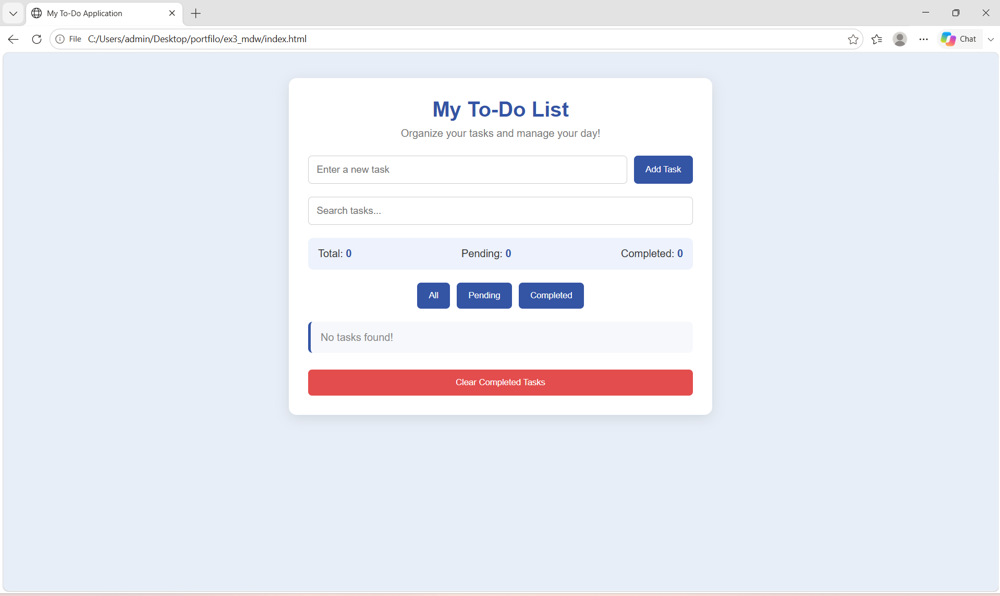

# Ex03 To-Do List using JavaScript

## Date: 17.11.2026

## AIM
To create a To-do Application with all features using JavaScript.

## ALGORITHM

### STEP 1
Build the HTML structure (index.html).

### STEP 2
Style the App (style.css).

### STEP 3
Plan the features the To-Do App should have.

### STEP 4
Create a To-do application using Javascript.

### STEP 5
Add functionalities.

### STEP 6
Test the App.

### STEP 7
Open the HTML file in a browser to check layout and functionality.

### STEP 8
Fix styling issues and refine content placement.

### STEP 9
Deploy the website.

### STEP 10
Upload to GitHub Pages for free hosting.

## PROGRAM

index.html

```

<!DOCTYPE html>
<html lang="en">
<head>
    <meta charset="UTF-8">
    <meta name="viewport" content="width=device-width, initial-scale=1.0">
    <title>My To-Do Application</title>
    <link rel="stylesheet" href="style.css">
</head>
<body>

    <div class="container">

        <header>
            <h1>My To-Do List</h1>
            <p>Organize your tasks and manage your day!</p>
        </header>

        <!-- TASK INPUT -->
        <div class="task-input">
            <input type="text" id="taskInput"
                   placeholder="Enter a new task">

            <button onclick="addTask()">Add Task</button>
        </div>

        <!-- SEARCH -->
        <input type="text" id="searchInput"
               placeholder="Search tasks..." oninput="displayTasks()">

        <!-- TASK COUNTS -->
        <div class="task-count">
            <div>Total: <span id="totalCount">0</span></div>
            <div>Pending: <span id="pendingCount">0</span></div>
            <div>Completed: <span id="completedCount">0</span></div>
        </div>

        <!-- FILTER BUTTONS -->
        <div class="filters">
            <button onclick="setFilter('all')">All</button>
            <button onclick="setFilter('pending')">Pending</button>
            <button onclick="setFilter('completed')">Completed</button>
        </div>

        <!-- TASK LIST -->
        <ul id="taskList"></ul>

        <!-- CLEAR COMPLETED -->
        <button class="clear-btn" onclick="clearCompleted()">
            Clear Completed Tasks
        </button>

    </div>

    <script src="script.js"></script>
</body>
</html>

```

style.css

```

/* GLOBAL STYLES */
* {
    margin: 0;
    padding: 0;
    box-sizing: border-box;
}

body {
    font-family: Arial, sans-serif;
    background: #e8eef7;
    color: #333;
    min-height: 100vh;
    padding: 40px 15px;
}

/* MAIN CONTAINER */
.container {
    max-width: 650px;
    margin: auto;
    background: white;
    padding: 30px;
    border-radius: 12px;
    box-shadow: 0 5px 20px rgba(0, 0, 0, 0.1);
}

/* HEADER */
header {
    text-align: center;
    margin-bottom: 25px;
}

header h1 {
    color: #3454a4;
    margin-bottom: 10px;
}

header p {
    color: #777;
}

/* TASK INPUT */
.task-input {
    display: flex;
    gap: 10px;
    margin-bottom: 20px;
}

input {
    padding: 12px;
    border: 1px solid #ccc;
    border-radius: 6px;
    font-size: 15px;
}

.task-input input {
    flex: 1;
    min-width: 0;
}

button {
    border: none;
    background: #3454a4;
    color: white;
    padding: 12px 18px;
    border-radius: 6px;
    cursor: pointer;
    transition: 0.3s;
}

button:hover {
    background: #243d80;
}

/* SEARCH */
#searchInput {
    width: 100%;
    margin-bottom: 20px;
}

/* TASK COUNTS */
.task-count {
    display: flex;
    justify-content: space-between;
    gap: 10px;
    background: #edf2fc;
    padding: 15px;
    border-radius: 8px;
    margin-bottom: 20px;
    text-align: center;
    flex-wrap: wrap;
}

.task-count span {
    font-weight: bold;
    color: #3454a4;
}

/* FILTERS */
.filters {
    display: flex;
    justify-content: center;
    gap: 10px;
    margin-bottom: 20px;
    flex-wrap: wrap;
}

/* TASK LIST */
#taskList {
    list-style: none;
}

#taskList li {
    display: flex;
    align-items: center;
    justify-content: space-between;
    gap: 10px;
    padding: 15px;
    margin-bottom: 10px;
    background: #f7f8fc;
    border-radius: 7px;
    border-left: 4px solid #3454a4;
}

.task-text {
    flex: 1;
    overflow-wrap: anywhere;
}

.completed {
    text-decoration: line-through;
    color: #999;
}

/* TASK ACTION BUTTONS */
.actions {
    display: flex;
    gap: 5px;
}

.actions button {
    padding: 7px 10px;
    font-size: 12px;
}

.edit-btn {
    background: #e6a23c;
}

.delete-btn {
    background: #e34d4d;
}

.edit-btn:hover {
    background: #c78620;
}

.delete-btn:hover {
    background: #c72e2e;
}

/* CLEAR BUTTON */
.clear-btn {
    width: 100%;
    margin-top: 15px;
    background: #e34d4d;
}

.clear-btn:hover {
    background: #c72e2e;
}

/* EMPTY MESSAGE */
.empty {
    text-align: center;
    color: #888;
    padding: 20px;
}

/* MOBILE DESIGN */
@media (max-width: 500px) {
    .container {
        padding: 20px;
    }

    .task-input {
        flex-direction: column;
    }

    .task-input button {
        width: 100%;
    }

    #taskList li {
        align-items: flex-start;
        flex-direction: column;
    }

    .actions {
        width: 100%;
    }
}

```

script.js

```

// GET HTML ELEMENTS
const taskInput = document.getElementById("taskInput");
const taskList = document.getElementById("taskList");
const searchInput = document.getElementById("searchInput");

// LOAD TASKS FROM LOCAL STORAGE
let tasks = JSON.parse(localStorage.getItem("tasks")) || [];
let currentFilter = "all";

// SAVE TASKS
function saveTasks() {
    localStorage.setItem("tasks", JSON.stringify(tasks));
}

// ADD TASK
function addTask() {
    const text = taskInput.value.trim();

    if (text === "") {
        alert("Please enter a task!");
        return;
    }

    tasks.push({
        id: Date.now(),
        text: text,
        completed: false
    });

    taskInput.value = "";

    saveTasks();
    displayTasks();
}

// ADD TASK USING ENTER KEY
taskInput.addEventListener("keydown", function(event) {
    if (event.key === "Enter") {
        addTask();
    }
});

// DISPLAY TASKS
function displayTasks() {
    taskList.innerHTML = "";

    const searchText = searchInput.value.toLowerCase();

    let filteredTasks = tasks.filter(function(task) {

        const matchesSearch = task.text.toLowerCase().includes(searchText);

        const matchesFilter =
            currentFilter === "all" ||
            (currentFilter === "pending" && !task.completed) ||
            (currentFilter === "completed" && task.completed);

        return matchesSearch && matchesFilter;
    });

    if (filteredTasks.length === 0) {
        taskList.innerHTML =
            '<li class="empty">No tasks found!</li>';
    }

    filteredTasks.forEach(function(task) {

        const li = document.createElement("li");

        const text = document.createElement("span");
        text.className = "task-text";
        text.textContent = task.text;

        if (task.completed) {
            text.classList.add("completed");
        }

        // COMPLETE BUTTON
        const completeBtn = document.createElement("button");
        completeBtn.textContent = task.completed ? "Undo" : "Done";

        completeBtn.onclick = function() {
            toggleTask(task.id);
        };

        // EDIT BUTTON
        const editBtn = document.createElement("button");
        editBtn.textContent = "Edit";
        editBtn.className = "edit-btn";

        editBtn.onclick = function() {
            editTask(task.id);
        };

        // DELETE BUTTON
        const deleteBtn = document.createElement("button");
        deleteBtn.textContent = "Delete";
        deleteBtn.className = "delete-btn";

        deleteBtn.onclick = function() {
            deleteTask(task.id);
        };

        const actions = document.createElement("div");
        actions.className = "actions";

        actions.appendChild(completeBtn);
        actions.appendChild(editBtn);
        actions.appendChild(deleteBtn);

        li.appendChild(text);
        li.appendChild(actions);

        taskList.appendChild(li);
    });

    updateCounts();
}

// COMPLETE OR UNDO TASK
function toggleTask(id) {
    tasks = tasks.map(function(task) {
        if (task.id === id) {
            task.completed = !task.completed;
        }
        return task;
    });

    saveTasks();
    displayTasks();
}

// EDIT TASK
function editTask(id) {
    const task = tasks.find(function(task) {
        return task.id === id;
    });

    const newText = prompt("Edit your task:", task.text);

    if (newText === null) {
        return;
    }

    if (newText.trim() === "") {
        alert("Task cannot be empty!");
        return;
    }

    task.text = newText.trim();

    saveTasks();
    displayTasks();
}

// DELETE TASK
function deleteTask(id) {
    if (confirm("Are you sure you want to delete this task?")) {
        tasks = tasks.filter(function(task) {
            return task.id !== id;
        });

        saveTasks();
        displayTasks();
    }
}

// FILTER TASKS
function setFilter(filter) {
    currentFilter = filter;
    displayTasks();
}

// CLEAR COMPLETED TASKS
function clearCompleted() {
    if (confirm("Delete all completed tasks?")) {
        tasks = tasks.filter(function(task) {
            return !task.completed;
        });

        saveTasks();
        displayTasks();
    }
}

// UPDATE TASK COUNTS
function updateCounts() {
    document.getElementById("totalCount").textContent = tasks.length;

    document.getElementById("pendingCount").textContent =
        tasks.filter(task => !task.completed).length;

    document.getElementById("completedCount").textContent =
        tasks.filter(task => task.completed).length;
}

// INITIAL DISPLAY
displayTasks();


```


## OUTPUT




## RESULT
The program for creating To-do list using JavaScript is executed successfully.
